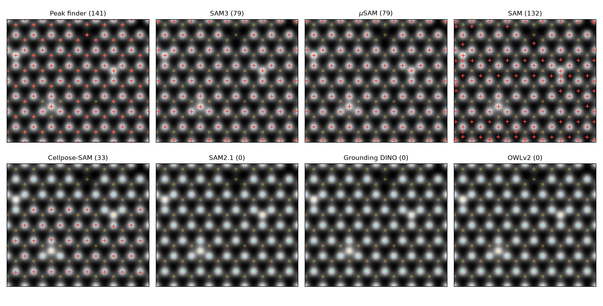
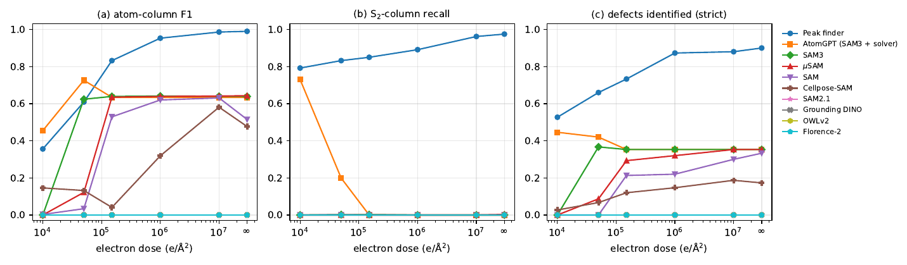

# microseg

**Can universal segmentation models find atoms and defects in STEM images?**

microseg is a labelled digital-twin benchmark for answering that question on monolayer MoS2. It has three parts:

- a generator for multislice HAADF-STEM images with exact atom-column and point-defect labels;
- a harness that runs eight general-purpose segmentation models zero-shot, plus the AtomGPT SAM3 service;
- scoring code that measures atom-column detection and defect identification across electron dose.



*Red crosses: detections. Ground truth: Mo columns (cyan) and S2 columns (yellow). Only the classical peak finder
sees the S2 sublattice.*

## Key results

Results are from 50 samples × 6 doses (300 images per model) and are on noise-free images unless stated.

| Model | Atom F1 | S2 recall | Defects identified | s / image |
|---|---|---|---|---|
| Peak finder (baseline) | **0.990** | **0.975** | **0.900** | 0.03 |
| AtomGPT production (SAM3 + solver) | 0.634 | 0.000 | 0.353 | ~3 (API) |
| SAM3 | 0.639 | 0.000 | 0.353 | 1.7 |
| µSAM (`vit_b_lm`) | 0.643 | 0.003 | 0.353 | 2.0 |
| SAM (ViT-H) | 0.515 | 0.000 | 0.333 | 12.5 |
| Cellpose-SAM | 0.477 | 0.000 | 0.173 | 3.0 |
| SAM2.1, Grounding DINO, OWLv2, Florence-2 | 0 | 0 | 0 | 1–9 |

- **No learned model finds the sulfur sublattice,** although S2 columns are 34% as bright as Mo. Every S-site defect
  is therefore missed: 0/37 single and 0/25 double S vacancies. The best models (SAM3, µSAM) find every Mo column and
  every Mo-site defect.
- **Four models return nothing usable.** SAM2.1, Grounding DINO and Florence-2 segment the whole image as one object;
  OWLv2 never scores a box above 0.04.
- **SAM3 is the most dose-robust learned model.** Its F1 stays at 0.62 down to 5×10⁴ e/Ų, while µSAM and SAM collapse
  below 1.5×10⁵. Every learned model returns nothing at 10⁴ e/Ų.
- **Dopant visibility is set by physics, not the model.** W and Re dopants are found; Nb and V, whose contrast is
  close to Mo, are not, for every method.



Full tables: [`results/summary.csv`](results/summary.csv) and
[`results/strict_recall_by_type.csv`](results/strict_recall_by_type.csv).

## Repository layout

```
microseg/
  generate_dataset.py   abTEM digital twins: images, masks, labels at several electron doses
  run_models.py         runs each segmentation model, reduces its output to atom-column centres
  evaluate_sam3.py      scores the AtomGPT /microscopy/segment API directly
  score_models.py       atom-column and defect metrics for every model
  lattice_defects.py    lattice / point-defect solver (from AtomGPT; see note below)
  make_figures.py       the figures above
results/                summary tables from the 50-sample run
figures/
```

## Install

Simulation and modelling use two environments. abTEM 1.0.0b32 needs a NumPy 2.x shim (built into the scripts), and
the models need a recent PyTorch.

```bash
# simulation
python3.11 -m venv .venv-sim
.venv-sim/bin/pip install -r requirements-sim.txt

# models (PyTorch >= 2.7 with CUDA 12.8 for RTX 50-series GPUs; transformers >= 5.2 for SAM3)
python3.11 -m venv .venv-models
.venv-models/bin/pip install -r requirements-models.txt
```

All models fit on an 8 GB GPU. SAM3 inference needs 2.4 GB in bf16. The SAM3 weights (`facebook/sam3`) are gated
on Hugging Face, so request access and log in with `huggingface-cli login`.

## Usage

**1. Input structure.** Download the defect-free MoS2 cell published with Fuhr et al.:

```bash
wget -O mos2-B_Defect-Free.vasp "https://www.dropbox.com/scl/fi/y2qfttb6i52uattjb32kr/mos2-B_Defect-Free.vasp?rlkey=wsd4615si57wnqucfw00cg8tv&dl=1"
```

**2. Generate the dataset.** 200 samples take about 30 s each on a laptop RTX 5060 (about 20× slower with
`--device cpu`). Interrupted runs resume where they stopped.

```bash
.venv-sim/bin/python -m microseg.generate_dataset --vasp mos2-B_Defect-Free.vasp --n 200 --out dataset
# WSL: prefix with NUMBA_CUDA_DRIVER=/usr/lib/wsl/lib/libcuda.so.1 so numba finds the GPU
```

**3. Run the models.** Outputs are cached per image, so reruns skip finished work.

```bash
for m in peaks sam3 microsam sam1 sam2 cellpose gdino owlv2 florence2; do
  .venv-models/bin/python -m microseg.run_models --model $m --data dataset --limit 50
done
```

**4. Optional: the AtomGPT service.** Send requests one at a time; parallel requests with one key can fail with 401.

```bash
export ATOMGPT_API_KEY=sk-...            # atomgpt.org > Profile > Settings > Account > API Keys
.venv-sim/bin/python -m microseg.evaluate_sam3 --data dataset --limit 50
.venv-models/bin/python -m microseg.run_models --model atomgpt --data dataset --limit 50
```

**5. Score and plot.**

```bash
.venv-models/bin/python -m microseg.score_models --data dataset --preds model_preds --out model_results
.venv-models/bin/python -m microseg.make_figures --out figures
```

## Dataset

Each sample is a 25.47 × 22.06 Å periodic cell of 2H-MoS2 (64 Mo and 64 S2 projected columns).

**Defects.** Each sample has 0–6 random point defects; 10% of samples are pristine. There are ten classes:

| Class | What it is |
|---|---|
| V_S | single S vacancy |
| V_S2 | double S vacancy (whole S2 column missing) |
| V_Mo | Mo vacancy |
| Mo_S | Mo replacing one S |
| Mo_S2 | Mo replacing a whole S2 column |
| S_Mo | S replacing Mo |
| TM_dopant | W, Re, Nb or V on a Mo site |
| TM_adatom | Mo or W above a hollow site |
| Mo_i | Mo interstitial in the hollow site, in the Mo plane |
| S_i | S interstitial in the hollow site, in the Mo plane |

**Simulation.** These follow the experiment-matched conditions of Fuhr et al.:

- abTEM multislice, 60 kV, 30 mrad semi-angle, Cs = 0;
- HAADF detector 80–200 mrad;
- 0.05 Å potential sampling and 1 Å slices;
- the whole periodic cell is scanned, so every defect appears exactly once.

**Images.** 637 × 551 px at 0.04 Å/px:

- `dose_inf.png`: 0.5 Å Gaussian blur, no noise;
- Poisson noise at 1e7, 1e6, 1.5e5, 5e4 and 1e4 e/Ų (`dose_<D>.png`);
- `clean.npy`: the unblurred float image.

**Labels.**

- `labels.json` lists every column and defect in Å and in pixels. Column positions match the simulated intensity
  peaks to within 0.1 px.
- `mask.png` is a per-pixel class mask; the class list is in `classes.json`.
- `structure.vasp` is the simulated structure.
- Pixel convention: `col = x / pixel_size_x`, `row = y / pixel_size_y`, row 0 at the top.

## Metrics

**Atom columns.** Predicted centres are matched one-to-one to the true columns (Hungarian assignment) within 0.5 Å,
giving precision, recall and F1. Recall is also split into Mo, S2 and defect columns. Points within 0.6 Å of the
border are ignored, because columns at the edge of the periodic cell are cut.

**Defects.** None of the models produces a lattice, so each model's centres go to the same lattice solver
(`lattice_defects.py`) with the solver's own peak finding switched off. The solver flags vacancies, off-lattice
atoms and intensity anomalies.

- A defect is **located** if any flag lies within 0.5 Å of it.
- It is **identified** if that flag is also the expected kind: a vacancy for missing atoms, an anomaly for
  substitutions, off-lattice for adatoms and interstitials.

## Solver note

`lattice_defects.py` is the AtomGPT microscopy solver with one change. Its peak finder spaced peaks at 0.25 of the
lattice period. In a honeycomb projection the nearest columns are only 1/√3 of the period apart, so that setting
suppressed every S2 peak. The bundled version scales the spacing by 1/√3. This does not change any benchmark number:
scoring runs with the solver's peak finder disabled, and rescoring with the fixed version reproduces
`results/summary.csv` exactly. The "AtomGPT production" row comes from the live service, which still ran the
original setting.

## Limitations

- The benchmark is simulated and covers one material.
- No frozen phonons, aberrations or scan distortion are included.
- Models ran zero-shot with default thresholds and the single prompt "dots".
- Several defect classes have only 6–16 instances in the 50-sample run.
- The peak-finder baseline was not tuned on the benchmark, but its settings assume the pixel scale.

## Citation

If you use this benchmark, please cite the digital-twin conditions it builds on:

> A. S. Fuhr, P. Ganesh, R. K. Vasudevan, K. M. Roccapriore, B. G. Sumpter,
> *Digital twins and deep learning segmentation of defects in monolayer MX2 phases*,
> Appl. Phys. Lett. **124**, 031901 (2024). https://doi.org/10.1063/5.0181080

A manuscript describing this benchmark is in preparation.

## License

Apache-2.0. See [LICENSE](LICENSE).
